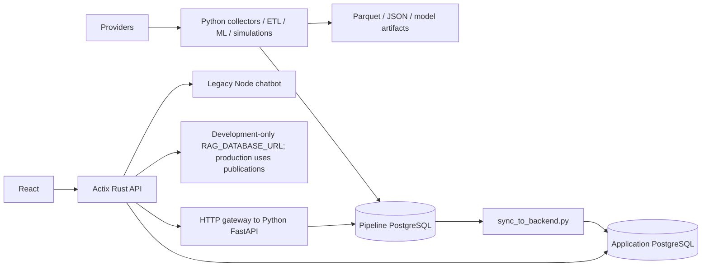

# Architecture audit — 2026-10-26

Status: first source-audit deliverable; **not a production-readiness certification**.
Baseline: `d8aaa59`, with substantial pre-existing tracked and untracked changes.
Those changes are part of the inspected working tree and must not be discarded.
No deployment, production migration, credential change, or model promotion has
been performed. Subsequent isolated development-branch validation is recorded below.

Continuation: durable sessions are implemented and independently HTTP-tested;
see `auth-session-design.md`. AI Picks generation now uses approved publication
records in production mode; see `published-ai-picks.md`. Baseline diagrams and
findings below describe the audited starting point. Remaining gateway and RAG
dependencies still block the final target architecture.

## Evidence and limits

Verified means observed in repository source on this date. Historical deployment
notes are explicitly identified as historical; they do not prove present cloud state.
Live table names and deployed project/environment names and scopes were
subsequently verified read-only. Full column/grant/checksum parity, secret values,
installed scheduler tasks, provider entitlements, Neon plan and production
performance remain unverified.
The shell sandbox repeatedly failed before process creation (`setup refresh had
errors`); read-only inspection succeeded with approved elevated execution.
`npx --no-install fallow --summary` initially failed because the package was absent.
Installing the explicit Windows binary allowed Fallow 3.36.0 to run: 197 files,
19 unused-file candidates, 17 unused-export candidates, one unresolved import,
43 clone groups / 1,737 duplicate lines (5.2%), 180 functions above complexity
threshold. Exit 1: the repository does not meet the tool's gates. Its root
node_modules warning limits dependency classification; none of these candidates
is authorization to delete source. Rust/Python require their own analysis.

## Current architecture (verified source)

* `backend/Cargo.toml`: Actix-web 4, Tokio, SQLx 0.7 PostgreSQL, Argon2,
  JWT, governor, tracing, BigDecimal, reqwest. Preserve this framework.
* `backend/src/main.rs`: long-running `HttpServer`; selected binary is
  `football-heritage-backend`. A separate `migrate` binary exists. Maintenance
  executables are feature-gated. Shared application pool defaults to max 10,
  min 1, acquire timeout 30 seconds. Migrations run at startup unless disabled.
* `pipeline/`: FastAPI/SQLAlchemy/psycopg2, pandas/Arrow/NumPy, sklearn,
  XGBoost and LightGBM. Processing and artifacts are partly database-backed,
  partly file-backed; the target diagram must not erase those existing workflows.
* `frontend/package.json`: React 19, TypeScript `^7.0.2`, Vite 7, Tailwind 4,
  TanStack Query 5, Zustand, Zod, React Router 7 already declared. Actual installed
  compiler reports TypeScript 7.0.2; full compatibility requires typecheck/build.
* `frontend/src/utils/api.js`: production HTTPS base validation; pipeline URL
  resolves to the Rust `/api/v1/pipeline` gateway, not a direct Python browser URL.
  SessionStorage bearer tokens, omitted cookies, explicit logout revocation.
* `frontend/src/App.jsx`: routes imported eagerly; vendor chunks in Vite do not
  supply route-based splitting. Auth/admin boundaries and safe return URL handling exist.

## Functionality and route inventory

Rust serves registration/login/logout/refresh/email verification, profiles,
password changes/activity, wallets/transactions, betting events and user bets,
responsible gambling limits/self-exclusion, sports/leagues/categories, props,
parlays/history, odds intelligence, AI pick runs/chat/conversations, feature
policy, administrative users/events/analytics/fraud/audit, health/readiness/metrics.
Admin bet management/settlement routes are commented out in `main.rs`; this is
an existing gap, not permission to enable financial operations without review.

Python domain routers are aggregated in `pipeline/api/routes.py`: intelligence,
predictions, core matches/health, matchup inference, assistant, parlay enrichment,
FPL, NCAAB, AI picks, candidate sport models, prediction dashboard, betting intelligence.
Public-looking route names do not mean public access is intended:
`pipeline/api/access.py` enforces an internal token in production. They remain
runtime dependencies behind Rust today and therefore violate offline independence.
`docs/api-inventory.md` records route registration evidence and migration classes.

## Pipeline job inventory

| Area | Existing entrypoints | Output / caution |
|---|---|---|
| Daily orchestration | `run_daily_fetch_with_sync.bat`, `run_daily_fetch.bat` | Collect, transform, load, forecast, refresh regional data, copy backend events; partial collection errors can continue |
| Weekly training | `run_weekly_retrain.bat` | Existing processed data; `models.train_model_v2`, `models.train_football_leagues --publish`, `models.predict_v2` |
| Football | `etl.fetch_raw_data`, `fetch_football_form`, `fetch_league_training`, `fetch_xg_data`, `transform`, `load_to_db`, `update_results` | Provider data, fixtures/results/form/xG; caches and fixed provider pacing exist |
| Basketball | `fetch_nba_data_wrapper`, `fetch_nba_data`, `fetch_ncaa_data`, `fetch_ncaab_odds`, `fetch_nba_cup_data`, `fetch_basketball_history`, `fetch_basketball_reference_async`, `fetch_historical_nba_odds`, `fetch_nba_public_odds` | NBA/NCAA/Cup/history/odds; collector existence does not prove feed access |
| American football | `fetch_americanfootball_history`, `fetch_gridiron_sources` | nflverse/nflfastR/CFBD, resumable saved assets |
| Sportsbook ingestion | `scrape_sportsbooks`, `regional_sportsbooks`, `scrapling_transport`, `sportsbook_parsers`, `nba_public_parsers`, `ingest_oddsapi_offers`, `ingest_player_props` | Preserve provider identity, capture provenance, exact fixture/time joins and stale-source exclusions |
| Regional publication | `scripts.refresh_regional_pipeline`, `sync_verified_odds`, `sync_bookmaker_grid` | Existing direct DB writes and file publication need individual ownership review |
| Models | `train_model_v2`, `predict_v2`, `train_sports`, `sport_predict`, `train_gridiron_sources`, `train_football_leagues`, `predict_football_leagues` | Preserve active/candidate distinction, features, chronological validation and numerical outputs |
| Simulation / research | `run_soccer_simulation`, `soccer_possessions`, `soccer_players`, `evaluate_soccer_players`, `backtest`, `market_demo`, `sport_market_demo` | Inactive research is not an approved production forecast |
| Trial operations | `scripts.run_trial_collection`, `refresh_trial_fixtures`, `refresh_paper_trial`, `assess_paper_trial`, `record_manual_paper_pick` | OS file lock prevents overlap for this collector; immutable evidence/settlement policies exist |
| Intelligence / fantasy | `compute_intelligence`, `compute_intelligence_v2`, `betting_intel`, `elo_model`, `fpl_optimizer`, `fetch_fpl_data`, `march_madness` | Some request handlers refresh data or infer synchronously |
| Existing replication | `sync_to_backend.py`, `scripts/sync_pegasus.ps1`, `scripts/install_pegasus_sync.ps1`, `backend/scripts/sync_pipeline_daily.py` | Inspect all callers before replacing; Pegasus is a distinct historical upstream topology |

Supported AI Picks request enum: Football, NBA, WNBA, NFL, NCAAB, College Football;
generation currently validates Football only. Generic ingestion config also lists
MLB/NHL; that does not establish trained production models for those sports.
Football competitions in config: PL, CL, EC, PD, BL1, SA, FL1, PPL, DED, ELC, BSA.
Configured World Cup IDs differ from the active string-code list.
Providers evidenced by collectors/config: football-data.org, The Odds API,
BALLDONTLIE, NCAA API, ESPN, FPL, nflverse/nflfastR, CFBD, Basketball Reference,
Wyscout public events, and per-book public feed adapters. Paid access and current
availability must be verified separately; do not infer success from an adapter.

## Database schema inventory

The baseline had 18 backend SQL migrations. This work adds publication migration
`20261026000001_published_data.sql` and durable-session migration
`20261026000002_persistent_auth_sessions.sql`, for 20 total. Main existing groups:

* Accounts/finance: `users` → `wallets`, `transactions`, `bets`,
  `gambling_limits`, `user_activity`, `betting_patterns`; `bets` → `events`.
* Administration: `admin_logs`, `platform_metrics`, `fraud_alerts` and added user roles.
* Parlays: `parlays` → `parlay_legs`; `parlay_calculations`;
  enhanced parlay migration adds further settlement/calculation fields.
* Markets: `events`, `sportsbook_registry`, `provider_events`, `odds_offers`,
  `devigged_odds`, `devigged_odds_archive`, `ev_bets`, `arbitrage`, `player_props`.
  Provider/event mapping and unique snapshot indexes already exist.
* AI/user state: `ai_pick_runs`, chat/conversation/message tables in the RAG
  migration, `ai_rag_documents`. User-created picks/conversations remain Neon-owned.
* Policy: feature flags, global settings, role/user feature rules, feature audit.
* Local declared schema: `matches` → `odds`, `predictions`, `prediction_history`.
  History has a unique match constraint and immutable intent. NBA/other model
  data also use tables created/managed from Python, outside this baseline SQL.

`pipeline/schema.sql` uses timestamp-without-time-zone and floating odds/probability
columns, indexes by match/date/status/team/bookmaker. It permits result labels
`home_win/draw/away_win`; legacy sync also expects H/A/D-style values in branches.
Do not normalize retrospectively without comparing actual stored data.
Backend migrations include decimal conversions for intelligence and uniqueness
for wallets/provider identities. A live catalog diff is needed before assuming
all declarations are applied. Existing applied migration bytes must be preserved
(see `backend/docs/MIGRATION_CHECKSUMS.md`). Financial, FK, index and constraint
behavior must be tested on an isolated database before adding migration changes.

## Current deployment topology

* `frontend/vercel.json`: Vite production-env validator, SPA fallback, asset cache
  headers and CSP. Separate API hostname must remain in `VITE_API_URL`; the broad
  SPA rewrite would swallow same-origin APIs unless API rewrites precede it.
* `deploy/vercel-services.example.json`: example multi-service container topology;
  this file alone does not establish an active hosted deployment.
* `backend/Dockerfile`: portable Linux Rust build, non-root runtime, separate
  migration binary. `.cargo/config.toml` defaults SQLX_OFFLINE, retains native CPU
  flags for non-container builds; portable serverless builds need verification.
* `.github/workflows/ci.yml`: Rust check/test, frontend lint/build, chatbot checks,
  Python compilation/unittest. `production-readiness.yml`: Postgres-backed Rust,
  browser and gateway checks. `vercel-preview.yml`: manually gated preview release.
* `deploy/staging/compose.yml`: private PostgreSQL/Python plus Rust, optional legacy
  chatbot/Redis, HTTPS web and isolated ports; still models the older HTTP topology.
* Historical 2026-10-24 notes report a working hosted CORS/startup repair and Neon
  URL correction. Those reports are historical evidence, not current smoke tests.
* Current official Rust docs describe `vercel_runtime` handlers while repository
  notes describe a standalone HTTP adapter. Preserve Actix and verify the precise
  deployed adapter/version before choosing an adapter or container configuration.
  Source: https://vercel.com/docs/functions/runtimes/rust (checked 2026-10-26).

## Security, correctness and performance findings

| Priority | Verified finding / exact source | Consequence / action |
|---|---|---|
| Critical architecture | `backend/src/pipeline_gateway.rs` forwards catch-all requests to `PIPELINE_API_URL`; builds a new HTTP client per request | Published Neon read models must replace all production forwarding before cutover |
| High | `backend/src/handlers/ai_picks.rs::generate` fetches Python `/ai-picks` | Generation currently fails without Python; move supported ranking to Rust over published predictions |
| Addressed in source 2026-10-26 | `backend/src/rag.rs` now shares the approved publication reader/application pool in published mode; legacy `RAG_DATABASE_URL` is development-only | Hosted rollout and remaining gateway contracts still pending; see `published-rag.md` |
| Critical at baseline; fixed in source | `backend/src/auth.rs` previously required an instance-local DashMap session | New runtime uses PostgreSQL sessions; independent-process HTTP/restart/revocation checks pass. Hosted rollout remains pending |
| High | `backend/src/handlers/intelligence.rs::refresh_intelligence` runs blocking Python subprocess and returns stderr | Serverless-incompatible; admin check exists in FeatureGate, but work must become a durable local job request/status, with sanitized responses |
| High | `sync_to_backend.py` fetches all matches/NBA rows, per-row lookups, destination advisory transaction lock | No durable capture/checkpoint/version/DLQ; cannot claim reliable incremental replication |
| High | `backend/src/handlers/chat.rs` slices prompt by byte offset before validation and logs prompt text | Non-ASCII can panic at a non-character boundary; avoid prompt logging and preserve auth |
| Medium | `pipeline/etl/load_to_db.py` uses shared named staging tables with `to_sql(if_exists='replace')`; some load failures are logged and continued | Concurrent ingestion can collide; investigate transactional temp tables/COPY and failure propagation with real DB tests |
| Medium | `pipeline/etl/utils.py` has fixed exponential retry without jitter; collectors also use fixed sleeps | Central provider-aware pacing/retry-after and bounded jitter need measured implementation |
| Medium | `pipeline/config.py` defaults API_HOST to 0.0.0.0; access token enforced when production or configured | Local tooling should bind loopback by default; never publish/tunnel this service |
| Medium | `frontend/src/App.jsx` eagerly imports pages | Route splitting is warranted; retain visual design and auth boundaries |
| Medium | `backend/src/main.rs` default startup migrations=true, per-instance pool max=10 | Explicitly disable at Vercel runtime, use migration identity and bounded aggregate connection budget |
| Verification gap | No fresh full test/benchmark/security scan yet; Fallow unavailable from local cache | Historical pass counts are not current results; measure before optimization |

Existing safeguards verified: exact production CORS validation, internal Python
token checks, parameterized sync SQL, destination sync advisory lock, provider-ID
event matching, current-role admin feature policy, readiness route, shared API
pool, model probability validation, immutable trial evidence and OS collector lock.
These must survive the refactor.

## Exact proposed migration sequence and affected files

1. Add versioned local publication/outbox contracts under `pipeline/sync/` and a
   new `pipeline/migrations/002_publication_outbox.sql`; add an additive backend
   publication migration (never edit applied files). Limit sync writes to a new
   publication schema, exclude all user/financial tables. Preserve existing jobs.
2. Implement publisher/checkpoints/reconciliation/worker plus tests under
   `pipeline/tests/`; use installed psycopg2 integration unless an evidenced need
   justifies psycopg3. Atomic database triggers capture approved publication rows;
   destination version guards and tombstones survive Neon-commit/local-ack loss.
3. Add `backend/src/published.rs`; adapt `pipeline_gateway.rs`, `handlers/ai_picks.rs`,
   `rag.rs`, `handlers/intelligence.rs`, `config.rs`, `main.rs`. Retain URL contracts
   while migrating endpoint families with response parity; production must never
   fall back to the local HTTP gateway. Missing prediction is explicit pending or
   unavailable, without fabricated probabilities or expected-error HTTP 500.
4. Integrate existing generators `models/predict_v2.py`, league predictions and
   snapshot producers only after output/identity/active-model parity is proved.
   Add publish calls within the same local transaction or publish a validated
   immutable bundle transactionally. Do not infer deletions from missing files.
5. Optimize `etl/load_to_db.py`, `etl/utils.py` and individual provider collectors
   based on isolated ingestion/query/feature/inference benchmark evidence.
6. Update `frontend/src/App.jsx`, `utils/api.js`, typed prediction contracts and
   consuming pages to preserve all flows and expose freshness/pending states.
7. Verify existing Vercel project settings/adapter, preview environments, portable
   builds, API routing, pooled TLS connections; update deployment docs/config only
   once compatibility is demonstrated. Production deployment requires approval.
8. Add local PowerShell setup/start/task integration reusing the existing collector
   overlap guard; record restart/resume/status and least-privilege setup.
9. Execute all required Rust/Python/frontend/integration/security/performance gates,
   reconciliation and offline-Python hosted smoke tests. Produce cutover evidence.

## Risks, dependencies and rollback

No source feature removal or irreversible schema migration is justified by this
audit. The existing dirty tree must be incorporated into a reviewed release
checkout, without reverting or silently committing unrelated work. Key risks are
ID collisions across providers/sports, history/candidate promotion mistakes,
timestamp interpretation, changed response shapes, FK ordering, cloud connection
budgets, and incompatible applied migration checksums. Use explicit stream
identity, per-record versions, additive tables, tombstones, contract comparisons,
bounded queues and isolated branch verification. External requirements: confirmed
Neon development branch/production project and scoped roles, Vercel project access,
production approval, trusted local Postgres test database, provider quotas and
representative benchmark fixtures.

Rollback: disable the new worker first, retain its queue/checkpoints and all
existing tables/artifacts, roll back the API/frontend to the recorded compatible
deployment. Never restore a stale full production backup over user transactions.
Retain new additive schema on code rollback. Do not re-enable production calls to
the user's computer as a rollback mechanism. Reconcile before resuming publishing.

## Hosted inventory and implementation follow-up

Read-only Neon inspection confirmed `footballheritage-staging`
(`withered-sky-66832245`, AWS us-east-2, PostgreSQL 17), primary branch `staging`
(`br-odd-unit-b4rvef3e`), application database `footballheritage_app_staging`
(38 tables/views including migration tracking) and separate prediction database
`footballheritage_predictions_staging` (`matches`, `nba_games`, `odds`,
`prediction_history`, `predictions`). User decision: **keep this project as
staging; specify production later**. No database-per-sport design is introduced.

Read-only catalog snapshots are included as
`footballheritage_app_staging-schema.json` (418 columns, 125 indexes, 115 constraints)
and `footballheritage_predictions_staging-schema.json` (76 columns, 17 indexes,
19 constraints). No row values, default expressions or credentials were exported.

Isolated child `codex-publication-contract-20261026` (`br-lucky-wind-b4r6rgn1`)
was created for migration validation. The exact additive publication SQL committed
there and its keys/FKs/checks were read back. A read-only parent check returned
`parent_staging_publication_schema_untouched = true`. The child is retained for
review. Account policy rejected a requested 300-second suspend interval; no
autosuspend guarantee is made. No credential or existing-branch mutation occurred.

Read-only Vercel inspection confirmed frontend `football-heritage-frontend`, root
`frontend`, framework Vite, and backend `footballheritage-backend`, root
`backend/src`, framework Rust. Both report Node 24.x build settings, production
branch `feature/footballheritage-frontend`, and latest READY deployments of
`d8aaa59745d008ebd630353bb2e90c89b7fe3a15`. READY is not a live smoke test.
Preview provisioning is incomplete: VITE_API_URL and backend env keys were
Production-scoped. Secret values were not printed or changed. The new
PUBLICATION_STREAM_ID is not configured in hosting.

This implementation adds native `/api/v1/predictions/{match_id}` using the
existing pool, explicit pending/withdrawn states, original probabilities and
freshness. Legacy gateway paths remain unchanged. Removing prompt logging fixes
the legacy chat UTF-8 slicing issue. Routes now use lazy imports/loading state.
Zod received a focused 4.x security update after an actual
[npm advisory finding](https://github.com/advisories/GHSA-mrhx-c7xc-m3w5).
See `stages/03-build/output/publication-foundation-20261026.md` for checks and
remaining gates. This is not a completed Rust-only production cutover.

Durable-session follow-up: runtime session persistence, validation and exact
logout now use the shared PostgreSQL pool. Registration is transactional across
account/wallet/limits/session. Real HTTP checks accepted a token in a second API
process and after restarting the first, propagated revocation, retained another
session, and verified rollback plus retry after an injected session-write failure.
Full 20-migration initialization and replay passed in a disposable local database.
The session DDL also passed on the isolated Neon child; both new schemas remain
absent on the parent staging branch. The refresh/email-verification routes are
still pre-existing message-only stubs; no completed flow is claimed for them.
