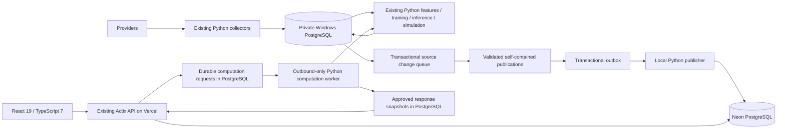

# Target architecture

Status: publication and durable gateway implementations are locally verified;
hosted rollout and production cutover are not complete.

Python owns computation and retains existing file artifacts, historical data,
candidate/active separation and numerical models. The production API reads
published records and never reaches the Windows host. Missing data has an explicit
pending/unavailable state; HTTP 500 is reserved for unexpected defects.

Existing `/api/v1/pipeline/...` browser paths are compatibility contracts despite
their legacy names. Migrate their implementations within Rust by domain, retaining
filters, pagination, auth and response shapes. Internal Python interfaces remain
loopback-only tools. Request-specific inference must use previously published
outputs or an explicit asynchronous request contract; do not generate substitute
probabilities. Large simulations stay local.

The initial publication transport uses three allowlisted aggregate datasets:
`fixture_bundle`, `model_metadata`, `simulation_bundle`. A fixture bundle contains
fixture identity, the existing stored model prediction, and bookmaker quotes in
one atomic record. This avoids exposing half a parent/child update. It supplements
the normalized application schema and existing provider mappings; it does not
replace user/event/market tables or claim every sport has the same statistics.
Additional sport adapters and identity mappings require explicit contracts.

The existing multi-sport, FPL, trial, intelligence and preview interfaces now use
the reviewed allowlist in `pipeline/sync/gateway_routes.json` and the separate
`published.gateway_jobs` protocol. Existing sport/provider IDs remain opaque,
stream-scoped source identities; no global ID is inferred from display names.
This does not expand the fixture transport's three-dataset allowlist. See
`durable-gateway.md` for asynchronous and idempotency contracts.

Initial football key: `football:legacy.matches:<match_id>`, scoped to the registered
source stream. This preserves existing local identity, without claiming it is an
official provider ID. Federated provider mapping remains a separate integration
step; production event UUIDs must not be re-created from display names.

Public APIs must expose generation time, model version, publication time and a
computed freshness state. Publication time never substitutes for model generation
time. Stale outputs may remain readable when clearly labeled; best-pick/EV ranking
must retain its existing evidence-age and kickoff restrictions.
